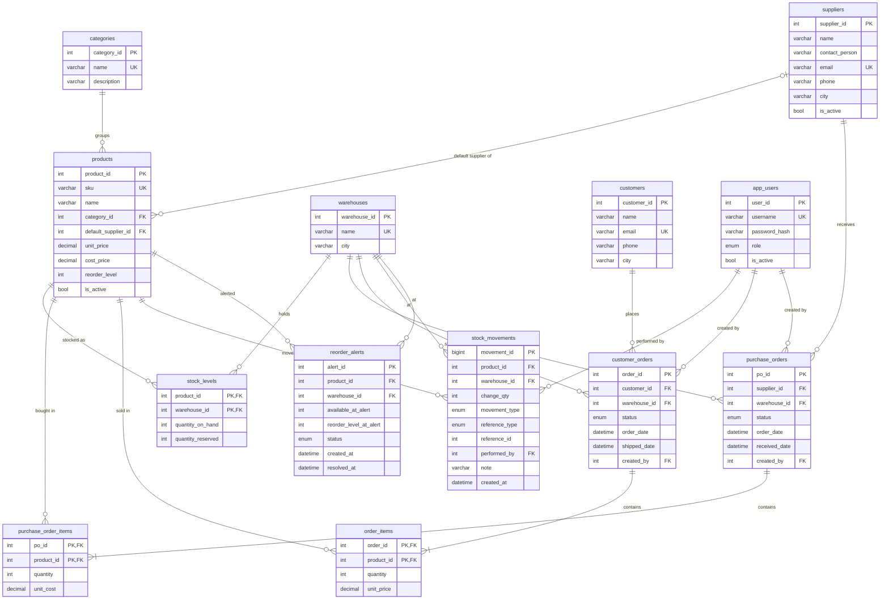

# ER Diagram: StockFlow

This diagram is written in Mermaid. To see it as a picture:
- in VS Code, install the extension **"Markdown Preview Mermaid Support"**, then open this file and press `Ctrl+Shift+V`
- or paste the code block into https://mermaid.live

For the report you can also draw it in MySQL Workbench: **Database > Reverse Engineer**, pick `stockflow`, and Workbench draws all tables and links for you.

## Relationships in words

| Relationship | Type | How it is stored |
|---|---|---|
| A category has many products | 1 to many | `products.category_id` |
| A supplier is the default supplier of many products (optional) | 0/1 to many | `products.default_supplier_id` (NULL allowed) |
| Products and warehouses | many to many | junction table `stock_levels` (one row per pair) |
| Purchase orders and products | many to many | junction table `purchase_order_items` |
| Customer orders and products | many to many | junction table `order_items` |
| Every stock change | many per product per warehouse | `stock_movements` (the ledger) |
